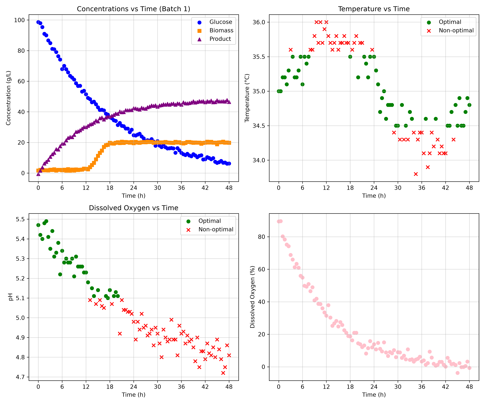

# Fermentation Bioprocess Monitoring Toolkit
An automated Python toolkit designed for monitoring operating parameter deviations from fermentation process datasets, generating performance dashboards and summary tables.

## Overview
This project provides an automated pipeline for monitoring batch fermentation performance and tracking whether critical operating conditions remain in defined ranges. It reads raw sensor time-series data, checks pH and temperature against acceptable ranges, creates visual 4-plot dashboards, and exports summary tables for simple process monitoring. By evaluating each run under both standard (Mode A) and strict (Mode B) operating windows, the toolkit makes it easy to spot parameter deviations and correlate them with final product yield. 

## Features
* **Batch Filtering**: Automatically extracts individual batch runs from multi-batch CSV datasets.

* **Standard vs Strict Operating Limits**: Evaluates batch data against both standard (Mode A) and strict (Mode B) limits to see how closely the process was controlled.

* **Deviation Detection**: Flags when pH and temperature readings fall outside acceptable limits using boolean masks.

* **4-Panel Dashboards**: Generates a 2x2 grid of scatter plots for every batch showing growth kinetics, temperature, pH, and dissolved oxygen against time. 

* **Automated Summary Tables**: Calculates the percentage of time each batch stayed within optimal limits for both modes and tracks the final product yield.

## Software Structure & Dependencies
### Technologies Used
* Python
* Pandas
* Matplotlib
* NumPy

### Code Design
The repository utilizes an object-oriented and modular structure including...
* `src/constants.py`: Stores limits for pH and temperature.
* `src/functions.py`: Holds simple helper functions like computing averages.
* `src/classes.py`: Contains two classes...
  * `Batch`: Stores batch ID and optimal operating setpoints (from mean of operation limits) for an individual fermentation run, printing them in terminal.
  * `BioprocessMonitor`: The main worker class that filters batches, checks bounds, builds plots, and exports tables.
* `main.py`: Loops through operating modes (Mode A and Mode B) and generates all figures and tables from the imported CSV data. 

## Generated Outputs 
### Dashboard Monitor
For each batch, a 4-panel dashboard is generated and saved to `figures/`. These figures contain the following plots:

* **Top-Left**: Glucose, Biomass, and Product concentration profiles ($g/L$) over elapsed time ($h$).
* **Top-Right**: Temperature profile, highlighting optimal setpoints (green circles) versus deviations outside acceptable bounds (red X markers).
* **Bottom-Left**: pH profile over time, indicating values within setpoints (green circles) and deviations (red X markers).
* **Bottom-Right**: Dissolved oxygen percentage ($DO%$) profile over time.

### Summary Table 
The summary CSV saved to `tables/` compares each batch across the following columns:

| batch_id | ph_optimal_percent | temperature_optimal_percent | C_product_g_L^-1_final |
| --- | --- | --- | --- |
| 1 | 93.81 | 97.94 | 46.5 |
| 2 | 96.69 | 97.52 | 50.8 |
| 3 | 95.89 | 93.15 | 44.6 |
| 4 | 100.0 | 96.47 | 48.6 |
| 5 | 48.62 | 99.08 | 24.7 |

* `batch_id`: The ID number of the fermentation run.
* `ph_optimal_percent`: Percentage of pH measurements that fell within the operation limits (rounded to 2 decimal places).
* `temperature_optimal_percent`: Percentage of temperature readings that stayed within the operation limits (rounded to 2 decimal places).
* `C_product_g_L^-1_final`: The final concentration of product obtained at the end of the batch.

This summary table is made for both standard (Mode A) and strict (Mode B) limits for easy comparison and to see how closely the process was controlled. 
